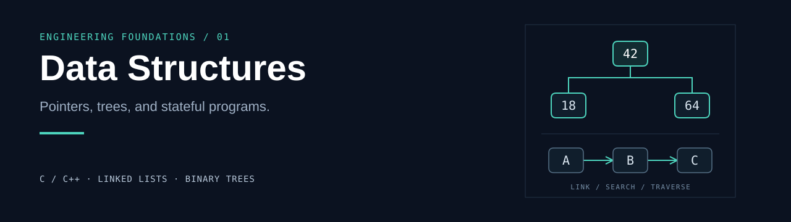

# Data Structures

연결 리스트, 이진 검색 트리, 정렬, 배열과 스택을 C/C++로 다루는 수업·학습 저장소입니다.
자료구조 실습과 이를 활용한 콘솔 프로그램, WinAPI 예제를 독립적인 Visual Studio 프로젝트로 정리했습니다.

`C / C++` · `MSVC v145` · `Windows SDK 10.0` · `Visual Studio`

[Projects](#projects) · [Repository Map](#repository-map) · [Getting Started](#getting-started) · [Project Notes](#project-notes) · [Related Work](#related-work)

## Projects

각 항목은 실제 소스에 담긴 학습 주제입니다. 프로젝트별 실행 소스와 준비 상태는 아래 안내를 확인해 주세요.

| Project | What it explores | Source |
| --- | --- | --- |
| **Champion Dictionary** | 챔피언 레코드를 원형 이중 연결 리스트로 관리하며 검색·삽입·삭제·정렬 연습 | [champion_dictionary.cpp](LOLDIC_double_linkedlist/LOLDIC_double_linkedlist/champion_dictionary.cpp) |
| **Binary Search Tree** | 이름 기반 삽입·검색·삭제, 중위 순회, 입력 파일 읽기 | [binary_search_tree_practice.cpp](Project3/Project3/binary_search_tree_practice.cpp) |
| **Linked List Exercises** | 단일·이중 연결 리스트 구성, 최대값 검색, 병합 정렬 | [linked_list_benchmark_practice.cpp](Time%20Complexity/Time%20Complexity/linked_list_benchmark_practice.cpp) |
| **Gomoku State Management** | 19×19 보드, 착수 기록 스택, 되돌리기·재실행, 저장·불러오기 | [save_load_back.cpp](save_load_back/save_load_back/save_load_back.cpp) |
| **Traffic Simulation** | WinAPI 이벤트와 타이머를 활용한 신호등·차량·보행자 처리 | [traffic_simulation.cpp](Project2/Project2/traffic_simulation.cpp) |

처음 살펴볼 예제로는 [Project3](Project3/)을 권합니다. `test.txt`의 데이터를 읽어 이름순으로 출력하며,
[별도 회귀 검사](Project3/tests/binary_search_tree_practice_test.cpp)로 삽입·검색·삭제의 주요 경우를 확인할 수 있습니다.

## Repository Map

```text
Data-Structure/
├── DataStructures/             # 기초 C 실습
├── Week02/ · Week03/           # 주차별 자료구조 실습
├── Week05/ · Week07/           # 레코드 관리와 보드 실습
├── LOLDIC_double_linkedlist/   # 원형 이중 연결 리스트
├── Project1/                  # 연결 리스트 실습
├── Project2/                  # WinAPI 교통 시뮬레이션
├── Project3/                  # 이진 검색 트리와 회귀 검사
├── Time Complexity/           # 연결 리스트·정렬 연습
├── 3 or 4 one space away/      # 보드 패턴 분석 실습
├── save_load_back/            # 보드 상태 저장과 착수 기록
├── Project4/                  # 소스가 없는 프로젝트 틀
├── Project5/                  # 외부 소스 복원이 필요한 프로젝트
└── data_structure/            # 소스가 없는 프로젝트 틀
```

`DataStructures/`와 `data_structure/`는 서로 다른 폴더입니다. 주차별 코드와 실습 변형은 원래 구성을 유지합니다.

## Getting Started

### Visual Studio

1. `.slnx`를 열 수 있는 Visual Studio와 **C++ 데스크톱 개발** 도구를 준비합니다.
2. 프로젝트 설정의 **MSVC `v145`** 도구 집합과 **Windows SDK 10.0**을 확인합니다.
3. [Project3.slnx](Project3/Project3.slnx)를 열고 `Debug` / `x64` 구성을 선택합니다.
4. 프로젝트의 디버깅 작업 디렉터리를 `$(ProjectDir)`로 설정해 [test.txt](Project3/Project3/test.txt)를 찾을 수 있게 합니다.
5. 프로젝트를 빌드한 뒤 실행합니다. 콘솔에 입력 레코드가 이름순으로 출력됩니다.

Visual Studio 개발자 터미널에서는 저장소 루트에서 다음과 같이 빌드할 수 있습니다.

```powershell
msbuild "Project3/Project3/Project3.vcxproj" /p:Configuration=Debug /p:Platform=x64
```

### Regression Check

이진 검색 트리 검사는 빈 트리, 중복 이름, 잎 노드, 자식이 하나·둘인 노드와 루트 삭제를 다룹니다.
Visual Studio 개발자 터미널에서 실행합니다.

```powershell
cd Project3/tests
cl /nologo /EHsc /std:c++20 binary_search_tree_practice_test.cpp
.\binary_search_tree_practice_test.exe
```

## Project Notes

- **독립 실습 선택:** 같은 폴더에 여러 `main()`을 가진 예제가 있을 수 있습니다. 실행할 소스와 `ExcludedFromBuild` 설정을 함께 확인하세요.
- **Champion Dictionary:** 현재 `Debug|x64` 구성에서는 `champion_dictionary.cpp`가 빌드 대상에서 제외되어 있습니다. 소스 실습을 보존한 상태입니다.
- **입력 파일:** 일부 예제는 `test.txt` 또는 `testdata.txt`를 상대 경로로 읽습니다. 해당 소스 폴더를 작업 디렉터리로 사용하세요.
- **Project5:** 외부 소스 5개가 로컬 원본에도 없어 빌드할 수 없는 상태입니다. [필요 파일 목록](Project5/README.md)을 확인하고 `Project5/Project5/external/`에 복원해야 합니다.
- **Starter projects:** `Project4/`와 `data_structure/`는 구현 소스가 없는 Visual Studio 프로젝트 틀입니다.

이 저장소에는 학습 과정의 실습 변형과 미완성 프로젝트가 함께 포함되어 있습니다.
각 폴더를 개별 실습 단위로 살펴보세요.

## Related Work

- [Computer Graphics](https://github.com/sanu1227/Computer-Graphics) — OpenGL 그래픽스 실습과 코드 해설
- [WinAPI](https://github.com/sanu1227/WinAPI) — Windows 메시지 처리, UI와 애니메이션 실습
